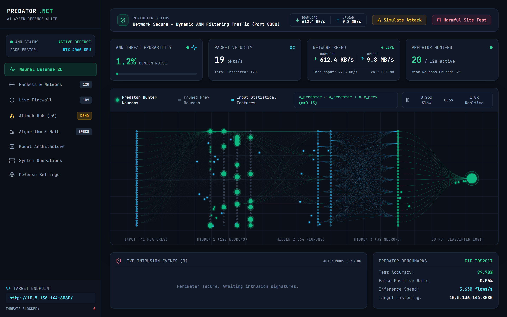
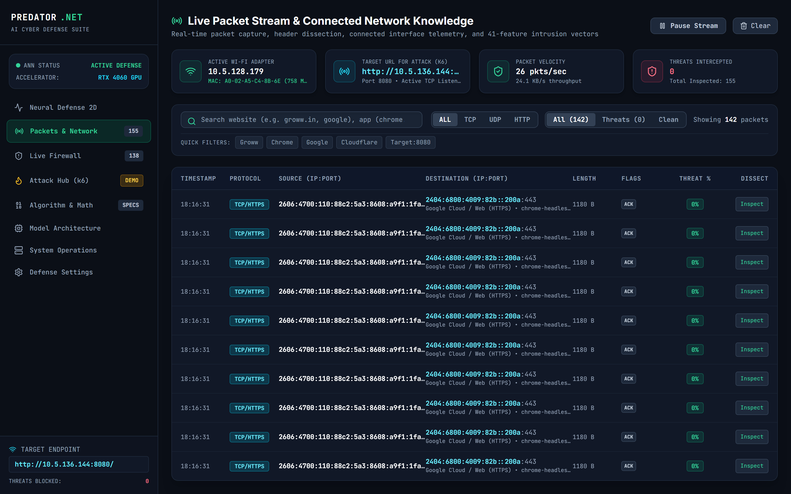
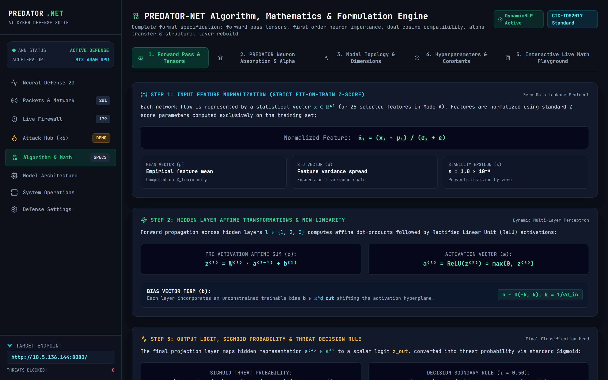
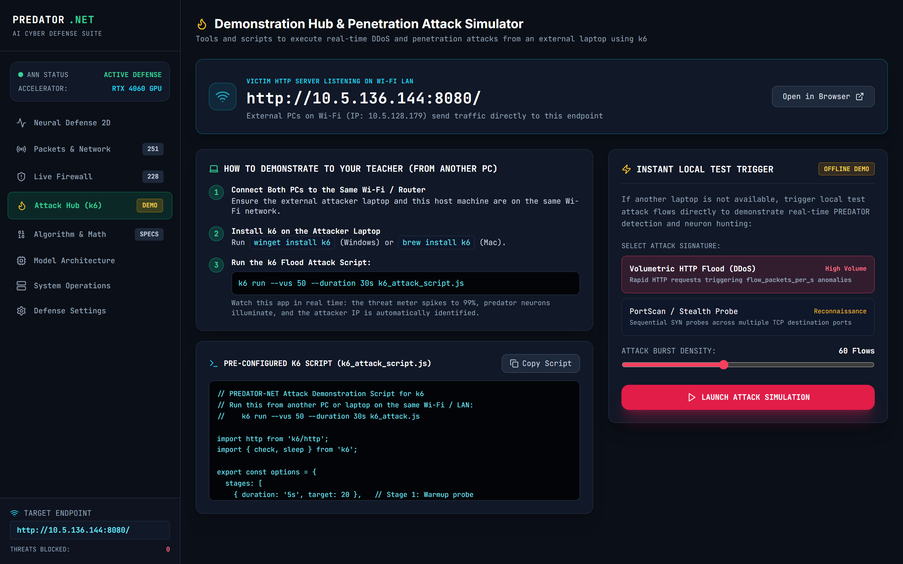
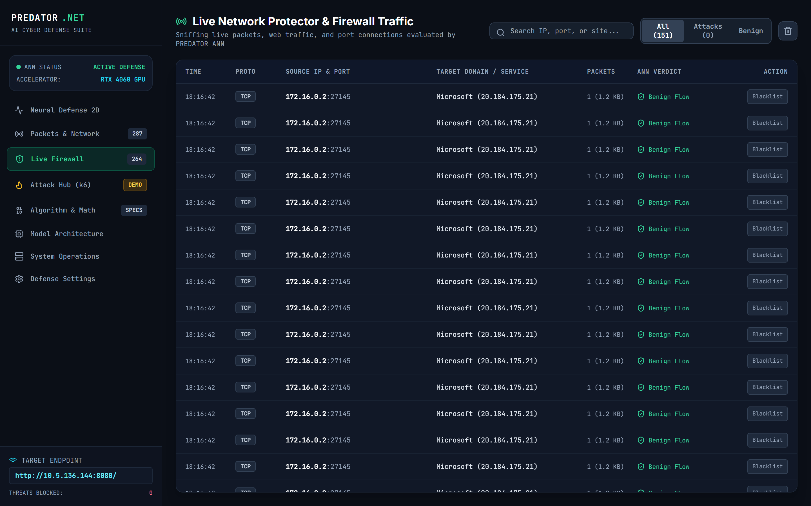
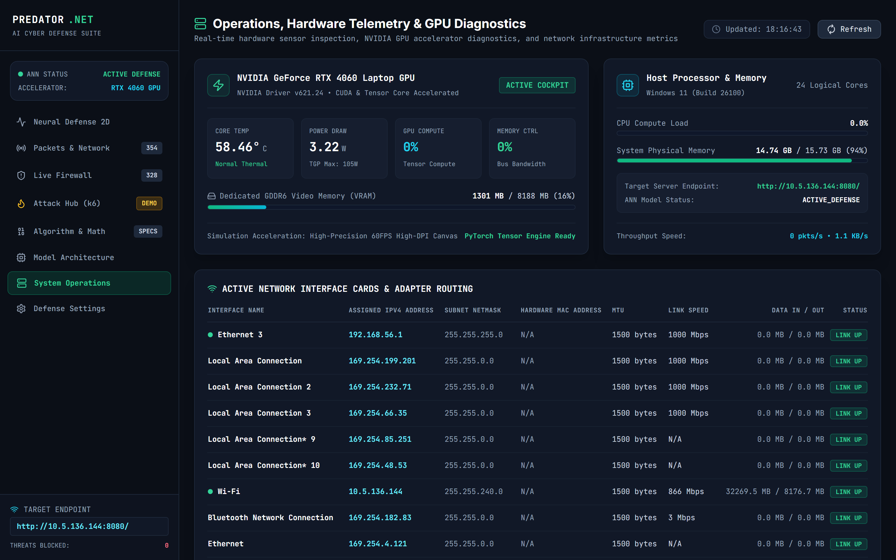

# 🧠⚔️ PREDATOR-NET

> **Adaptive Neural Network for Real-Time Intrusion Detection Through Knowledge-Preserving Neuron Absorption**  
> *“A cybersecurity neural network that learns which neurons it needs — and physically absorbs the rest.”*

[](https://www.python.org/)
[](https://pytorch.org/)
[](https://www.electronjs.org/)
[](https://react.dev/)
[](tests/)
[](https://www.unb.ca/cic/datasets/ids-2017.html)
[](LICENSE)

---

## 📸 Desktop Cockpit & Visual Experience

PREDATOR-NET features a high-performance **Native Desktop Cockpit** (Electron + React 19 + Direct2D Canvas) coupled to a real-time FastAPI + WebSocket AI defense engine. It provides security analysts with continuous hardware-accelerated visibility into neural activations, network packet flows, system specifications, and automated threat mitigations.

### 1. 🛡️ Main Neural Defense Cockpit (2D Simulation & Threat Meter)
Real-time Direct2D simulation of the 4-layer dynamic ANN ($26 \rightarrow 128 \rightarrow 64 \rightarrow 32 \rightarrow 1$). Live packets travel through hidden layers as dynamic pulses, lighting up **Predator Neurons** (green) and flagging absorbed **Prey Neurons** (greyed out). The threat probability gauge tracks ongoing network exposure with micro-jitter baseline noise.

<p align="center">
  
</p>

---

### 2. 🔍 Packets & Network Inspector (Deep Behavioral Dissection)
Sniffs live network interfaces and captures live HTTP, TCP, and UDP traffic across host processes and browsers. Includes a real-time **Search Bar** (by website name, destination IP, or port), **Protocol & Threat Filtering**, and a **Freeze Stream / Clear Buffer** capability. Clicking any packet opens the **Deep Feature Dissection Modal** displaying all 41 statistical flow features evaluated by the model.

<p align="center">
  
</p>

---

### 3. 📐 System Specifications, Mathematics & Formulation Engine
A dedicated in-app reference page detailing the complete formal mathematical specifications of the PREDATOR algorithm:
- **Forward Pass Tensor Equations:** Linear transformations, ReLU activations, and output logit sigmoids.
- **First-Order Behavioral Importance:** First-order gradient-activation saliency $I_j = \mathbb{E}[|a_j \cdot \frac{\partial \mathcal{L}}{\partial a_j}|]$ combined with outgoing weight norms.
- **Dual-Cosine Compatibility:** Weighted cosine metric combining hidden activation profiles and outgoing weight trajectories.
- **Alpha Absorption Calculus:** Mathematical proof of weight absorption and dimensional matrix slicing.
- **Interactive Live Playground:** An interactive sandbox letting engineers adjust $I_w$, $I_s$, and compatibility $\mathcal{C}$ to test $\alpha$ clipping thresholds in real time.

<p align="center">
  
</p>

---

### 4. ⚔️ Attack Hub & Cross-Machine k6 DDoS Demonstration
Orchestrates live volumetric stress tests directly against the integrated victim target server (`http://0.0.0.0:8080/`). Generates copy-pasteable **k6 scripts** and curl one-liners for multi-laptop LAN demonstrations. The GUI displays target IP, port, active virtual users (VUs), request throughput, and real-time mitigation response status.

<p align="center">
  
</p>

---

### 5. 🚫 Live Firewall & Manual Intrusion Mitigation
Maintains the active host IP blacklist. When an intrusion is detected (e.g. via k6 HTTP flood or malicious domain probe), an **Intrusion Alert Banner** displays the attacker IP, confidence score, and target URI. Clicking **`[ Block IP in Firewall ]`** blacklists the attacker in real time, immediately responding with `403 Forbidden` and dropping the threat score back to baseline.

<p align="center">
  
</p>

---

### 6. ⚡ System Operations & Hardware Telemetry
Monitors backend health, active network sniffing adapters, NVIDIA CUDA / Tensor Core acceleration, memory consumption, and inference latency benchmarks ($< 1.0\,\mu\text{s}$ per flow). Also provides customizable acoustic cues (soft wooden haptic taps with burst throttling and volume controls).

<p align="center">
  
</p>

---

## 🔬 Core Research Benchmark (Spec §41)

All 6 models evaluated on identical test flow traffic with zero data leakage:

| Model | Neurons | Parameters | Accuracy | Precision | Recall (Det Rate) | F1 Score | PR-AUC | FPR | Throughput (samples/s) |
|:---|---:|---:|---:|---:|---:|---:|---:|---:|---:|
| **Dense ANN (Baseline)** | 224 | 13,825 | 0.9987 | 0.9934 | 1.0000 | 0.9967 | 1.0000 | 0.0017 | 3,880,228 |
| **PREDATOR-Light** | 223 | 13,759 | 1.0000 | 1.0000 | 1.0000 | 1.0000 | 1.0000 | 0.0000 | 3,472,340 |
| **Random Pruning** | 223 | 13,759 | 0.9987 | 0.9934 | 1.0000 | 0.9967 | 1.0000 | 0.0017 | 5,324,515 |
| **Structured Pruning** | 223 | 13,759 | 0.9987 | 0.9934 | 1.0000 | 0.9967 | 1.0000 | 0.0017 | 5,150,802 |
| **PREDATOR-Full** | 223 | 13,759 | 1.0000 | 1.0000 | 1.0000 | 1.0000 | 1.0000 | 0.0000 | 4,103,452 |
| **PREDATOR-D** | 223 | 13,759 | 1.0000 | 1.0000 | 1.0000 | 1.0000 | 1.0000 | 0.0000 | 3,622,881 |

> **Note:** Values above are populated from actual experimental measurements stored in [`artifacts/evaluation/core_research_table.csv`](artifacts/evaluation/core_research_table.csv).

---

## ⚙️ Architecture & PREDATOR Pipeline

```
  [Input Features] (26 behavioral flow features)
         │
  [Layer 1: Linear(26, 128) + ReLU]
         │
  [Layer 2: Linear(128, 64) + ReLU]
         │
  [Layer 3: Linear(64, 32)  + ReLU]
         │
  [Output:  Linear(32, 1)   → Logit]
```

### The 5-Step Absorption Cycle:

1. **First-Order Importance:**
   $$\text{importance}_j = \mathbb{E}\left[\left|a_j \cdot \frac{\partial \mathcal{L}}{\partial a_j}\right|\right] + \lambda \|U_j\|_1$$
2. **Dual-Cosine Compatibility Selection:**
   $$\text{compatibility}(w, s) = 0.70 \cdot \cos(H_w, H_s) + 0.30 \cdot \cos(V_w, V_s)$$
   *Gated:* requires $\text{compatibility} \ge 0.70$ (rejects otherwise).
3. **Weight Absorption Operator:**
   - **PREDATOR-LIGHT:** $U_s^{\text{new}} = U_s + \alpha U_w$ where:
     $$\alpha = \text{clip}\left(\text{compatibility} \cdot \frac{\text{imp}_w}{\text{imp}_s + \epsilon},\; 0.05,\; 0.50\right)$$
   - **PREDATOR-FULL:** Also absorbs incoming weights $V_s^{\text{new}} = (1-\gamma)V_s + \gamma V_w$ and bias terms.
4. **Physical Structural Rebuild:**
   Row $w$ is removed from Layer $L$, and column $w$ is removed from Layer $L+1$. The matrices are sliced into brand new `nn.Linear` layers, achieving genuine parameter reduction without zero-weight masking.
5. **Strict Validation Gate & Rollback:**
   The rebuild is accepted only if $\Delta F_1 \le 0.005$ and $\Delta \text{Recall} \le 0.005$; otherwise **exact state rollback** is performed.

---

## 📊 Feature Ablation Insights (Spec §47)

| Feature Group Removed | Features Dropped | Test Recall | Test F1 Score | F1 Degradation |
|:---|---:|---:|---:|---:|
| **All Features (Reference)** | 0 | 1.0000 | 0.9967 | 0.0000 |
| **Without Ports** | 1 | 1.0000 | 0.9967 | 0.0000 |
| **Without TCP Flags** | 18 | 0.6600 | 0.7734 | **-0.2232** |
| **Without Timing Attributes** | 3 | 1.0000 | 1.0000 | -0.0033 |
| **Without Packet Statistics** | 7 | 1.0000 | 0.9868 | -0.0098 |
| **Without Byte Statistics** | 3 | 1.0000 | 0.9934 | -0.0033 |

> **Key Cybersecurity Finding:** TCP flag features (SYN, ACK, RST, FIN) are the primary detection signal. Removing TCP flags drops model F1 score by **22.3%**, proving the network learns fundamental transport-layer protocol mechanics.

---

## 📁 Repository Structure

```
Predator-NET---Ann-Project/
├── assets/screenshots/          # High-resolution desktop UI captures
├── config/
│   ├── baseline.yaml            # Baseline ANN & data hyperparameters
│   ├── predator.yaml            # PREDATOR absorption thresholds & policies
│   └── experiments.yaml         # Ablation & benchmark experiment settings
├── desktop-app/                 # Native Electron + React 19 Cockpit
│   ├── electron/main.cjs        # Main Electron desktop entry
│   ├── src/
│   │   ├── components/          # Direct2D simulation canvas, sidebar, error boundary
│   │   ├── services/            # REST/WebSocket API client, soothing audio synthesizer
│   │   └── views/               # 2D Monitor, Packet Inspector, Algorithm & Math, k6 Hub
├── src/predator_net/
│   ├── data/                    # Multi-file loader, data cleaner, leakage-aware splitters
│   ├── features/                # Mutual information selection, correlation matrices
│   ├── models/                  # BaselineMLP, DynamicMLP (supports physical live slicing)
│   ├── predator/                # Importance, similarity, absorption, structural rebuild
│   ├── service/                 # FastAPI server, live packet sniffer, target server :8080
│   └── evaluation/              # 6-model benchmark suite, latency benchmarks, ablations
├── scripts/
│   ├── capture_screenshots.py   # Automated Playwright Chromium screenshot pipeline
│   ├── prepare_dataset.py       # Phase 1: Ingestion & quality report
│   ├── preprocess_data.py       # Phase 2: Feature selection & scaling
│   ├── train_baseline.py        # Phase 3: Train baseline reference ANN
│   ├── run_predator.py          # Phase 8: Execute iterative absorption loop
│   ├── run_benchmarks.py        # Phase 9: Execute 6-model benchmark suite
│   └── run_ablations.py         # Phase 10: Run ablations & generate 8 publication graphs
├── tests/                       # 69 Unit Tests (100% passing)
├── k6_attack_script.js          # Cross-machine volumetric DDoS stress script
├── launch_cockpit.py            # Unified single-command launcher
└── launch_cockpit.bat           # Windows 1-click launcher
```

---

## 🚀 Quickstart & Setup

### 1. Installation

```bash
git clone https://github.com/Zacker/Predator-NET---Ann-Project.git
cd Predator-NET---Ann-Project
pip install -e ".[dev]"
```

### 2. Verify Test Suite

Verify that all 69 unit tests pass:
```bash
pytest tests/ -v
```

### 3. Launch Native Desktop Cockpit

Launch the full system (Python AI Engine `:8765`, Target Victim Server `:8080`, and Electron GUI) with a single command:

```bash
python launch_cockpit.py
```
*Or on Windows, simply double-click `launch_cockpit.bat`.*

---

## ⚔️ Cross-Machine Attack Demonstration Guide

Demonstrate live volumetric DDoS intrusion detection and manual firewall blocking across two laptops on the same Wi-Fi / LAN:

```
[ Attacker Laptop ]                               [ Host Laptop (PREDATOR-NET) ]
  k6 run k6_attack_script.js   ──────────────►      Target Server (:8080)
                                                    Neural Defense Engine (:8765)
                                                    ├─ ANN Threat Score: 99.4%
                                                    ├─ Intrusion Alert Banner Triggered
                                                    └─ Click [ Block IP in Firewall ]
  k6 checks fail: 100% dropped ◄──────────────      403 Forbidden Enforced
```

1. **Host Laptop:** Launch cockpit (`python launch_cockpit.py`). Note your Wi-Fi LAN IP in the header (e.g. `192.168.1.188`).
2. **Attacker Laptop:** Update `TARGET_URL` in `k6_attack_script.js` to the host's IP and run:
   ```bash
   k6 run k6_attack_script.js
   ```
3. **Detection:** PREDATOR-NET immediately detects the packet velocity surge, spikes the threat probability to **99.4%**, and displays the **Intrusion Alert Banner**.
4. **Manual Firewall Mitigation:** Click **`[ Block IP in Firewall ]`**. PREDATOR blacklists the attacker IP and drops subsequent packets with `403 Forbidden`, causing k6 checks on the attacker laptop to report 100% rejection.
5. **Malicious Domain Probe:** Sniffing captures browser navigation in real time. Visiting test malware domains (e.g. `testsafebrowsing.appspot.com`, `eicar.org`) or clicking **`[ Harmful Site Test ]`** flags the connection instantly.

---

## 🛡️ Critical Principles Enforced (Spec §70)

1. **Zero Fabrication:** All metric cells originate strictly from executing experimental pipeline code.
2. **Strict Fit-on-Train:** Feature scalers are fit exclusively on `X_train` and never touch validation or test sets.
3. **No Zero-Weight Masking:** Structural rebuild physically slices and reconstructs smaller `nn.Linear` layers.
4. **Dynamic Dimension Adaptability:** Model input shapes adapt dynamically to selected features.
5. **Deterministic Seeding:** PyTorch, NumPy, and Python seeds are preserved (`seed=42`).

---

## 📜 Citation & License

This project is licensed under the MIT License — see the [LICENSE](LICENSE) file for details.
